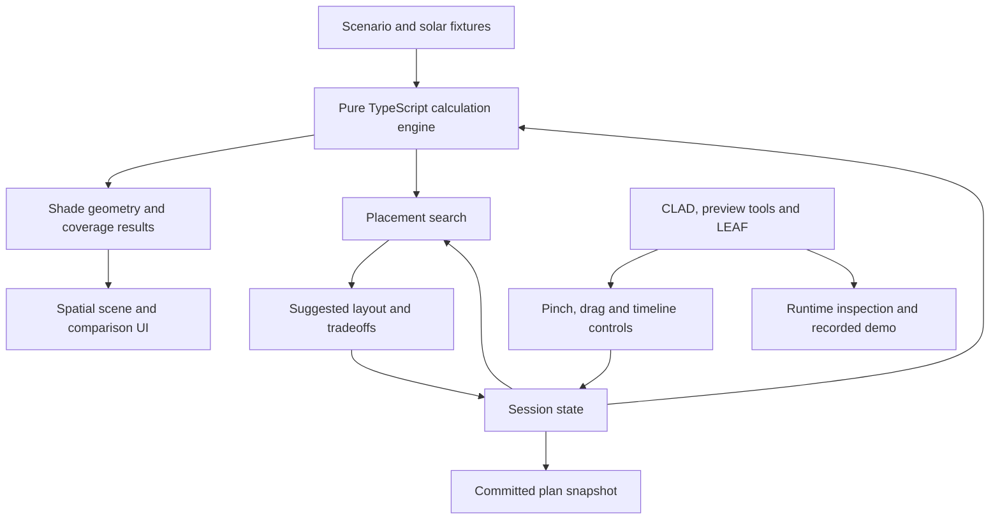

# Kirosho: technical implementation and competition plan

## 1. Product contract and competitive direction

### The problem and intended user

Build Kirosho for facilities and event planners deciding where to place a limited number of portable shelters.

The specific problem: a shelter can appear correctly positioned while providing poor shade during the hours people actually occupy a space.

**Product promise:** “Place the shelters you already own where they provide the most useful shade throughout your activity schedule.”

The prototype will help a planner:

- See how shade moves through an afternoon.
- Match shelter placement to scheduled use of different areas.
- Compare their starting layout with a calculated alternative.
- Understand which groups gain or lose coverage before accepting a change.

Its differentiation is the combination of **spatial planning, occupancy schedules, limited shelter inventory, and an explainable placement recommendation**. We will acknowledge existing AR shade-design work and make this narrower contribution explicit.

### A version Codex can operate completely

The core experience will be a **tabletop spatial planning model**, with a full-scale inspection mode.

This removes dependencies on site scanning, glasses, live camera recognition, outdoor filming, or your physical movement. The spatial model itself is the product being manipulated.

The complete demonstration will run inside Lens Studio. Codex will operate its controls and virtual camera.

### Fixed v1 scope

| Element | Decision |
|---|---|
| Primary scenario | A fictional Singapore school courtyard |
| Courtyard | 12 m × 8 m |
| Available inventory | Two identical 3 m × 3 m shelters, roof height 2.8 m |
| Activities | Lunch queue, outdoor seating, afternoon pickup queue |
| Planning period | 12:00–17:00 Singapore time |
| Solar reference | Singapore coordinates, 20 October 2026 |
| Placement | Ground-plane translation, north-aligned shelters |
| Constraints | Courtyard boundaries, shelter overlap, a marked access corridor |
| Runtime | Local and offline after installation |
| External services | None required for application behavior |
| Planning output | Baseline comparison, recommended layout, per-zone results, committed plan summary |

The courtyard and occupancy schedules will be labeled **illustrative scenario data**. Solar positions will be calculated for the stated location and date.

V1 excludes automatic site recognition, structural design, weather forecasting, thermal simulation, and claims about measured temperature reductions or avoided emissions.

### Success criteria

The completed Lens must demonstrate this sequence:

**Load courtyard → inspect afternoon shade → move a shelter → observe recalculated coverage → request a better layout → inspect its tradeoffs → apply or undo → inspect at full scale → commit the plan.**

The result must remain responsive, reproducible, and understandable without narration.

## 2. Product experience and technical architecture

### Spatial interaction design

Use a civic planning maquette: warm neutral surfaces, restrained geometry, amber sunlight indicators, and cyan shade-analysis overlays.

The model should dominate the view. Controls remain small in number and attached to the planning task.

| Surface | Behavior |
|---|---|
| Tabletop model | Approximately 60 cm × 40 cm, representing the courtyard at 1:20 scale |
| Shelter handles | Large, forgiving pinch-and-drag targets |
| Time control | One timeline with clear activity-period labels |
| Selected zone | Occupancy schedule, current coverage, and whole-period coverage |
| Comparison | Starting layout versus current or suggested layout |
| Main action | “Find better placement,” followed by “Apply layout” |
| Recovery | Undo, reset, cancel search, and return to overview |
| Inspection | Full-scale view at predefined observation points |

The model will be world-anchored during the session. A recall control brings the overview back into a comfortable position.

Full-scale inspection will preserve the same geometry and calculations. It will reposition the virtual model around a predefined observation point; it will not require you to move or imply that the courtyard was scanned.

Use standard SIK interactions throughout. Buttons come from SPECS UI Kit; draggable shelter handles use SIK interactables. This makes the same interaction paths available to preview automation and LEAF tests.

### Architecture



The calculation engine will remain independent of Lens Studio globals. Node tests and the Lens will execute the same TypeScript implementation.

Lens-specific components will handle input, scene transforms, rendering, UI, and lifecycle events.

### Solar calculations

Generate offline solar-position fixtures using pvlib’s implementation of the NREL Solar Position Algorithm. Record the generator version, coordinates, date, timezone, and generation inputs. [pvlib SPA documentation](https://pvlib-python.readthedocs.io/en/stable/reference/generated/pvlib.solarposition.spa_python.html)

Generate:

- One-minute solar samples for smooth timeline inspection.
- Five-minute midpoint samples for whole-period evaluation.
- Reference cases for independent verification.

Store normalized east/north/up sun vectors. All timestamps must have explicit timezone handling.

The Lens will interpolate the inspection samples. Scoring and optimization will use the fixed evaluation samples, ensuring repeatable results.

No network request or language-model output will determine shade geometry.

### Shade geometry and coverage

Keep the analytical model deliberately small and defensible:

- Flat, rectangular shelter roofs.
- Rectangular occupancy zones.
- Known shelter dimensions and heights.
- A flat site with explicitly modeled placement constraints.

For each zone, project the roof onto its activity plane:

```text
shadow offset =
  −(roof height − activity height)
  × (sun east / sun up, sun north / sun up)
```

Use activity heights of 1.2 m for seating and 1.6 m for standing queues. When a zone is selected, show the matching analysis plane and its height.

Because the roofs remain north-aligned, projected shadows remain rectangles. Coverage can therefore use exact rectangle intersections and inclusion–exclusion for the two shelters, avoiding double-counting overlapping shade.

Aggregate the results as:

```text
modeled shaded person-minutes =
  Σ(people present × shaded zone fraction × interval minutes)

coverage percentage =
  shaded person-minutes / scheduled person-minutes × 100
```

Assume people are distributed uniformly within each zone. Explain this assumption in the model-details panel.

Report:

- Current-time zone coverage.
- Whole-period coverage.
- Shaded person-minutes.
- Change from the starting layout.
- Per-zone gains and losses.

Use **percentage-point changes** when comparing coverage percentages. Never substitute these results for temperature, health, or carbon measurements.

### Placement optimization

Search the permitted placements on a 0.5 m grid.

For the proposed courtyard and corridor, the feasibility calculation produced 132 candidate centers and 5,436 valid two-shelter layouts. The implementation will regenerate these from the actual scenario configuration.

For every valid layout:

1. Reject boundary, corridor, and shelter-overlap violations.
2. Evaluate the same shade model used by the UI.
3. Calculate whole-period shaded person-minutes.
4. Rank by total coverage.
5. Break ties by the least movement from the starting layout, then stable coordinate order.

The result is the **best evaluated grid layout**, not a claim of continuous global optimality.

The recommendation must include its per-zone comparison. A higher overall score must not conceal a zone losing coverage.

Search will run in short work batches so rendering remains responsive. Show real progress and allow cancellation. A recommendation is previewed before application; applying it is one undoable action.

### State and internal interfaces

No external HTTP API or backend is required.

| Contract | Contents |
|---|---|
| `SiteScenario` | Site dimensions, solar metadata, activity zones, schedules, inventory, and blocked areas |
| `Layout` | Shelter identifiers and positions in meters |
| `ShadeEvaluation` | Input revision, time, per-zone coverage, totals, and calculation status |
| `PlacementSuggestion` | Proposed layout, evaluated-candidate count, comparison, and search status |
| `PlanSnapshot` | Scenario identifier, layout, results, model version, and input hashes |

Core operations:

- Project a roof shadow onto an activity plane.
- Validate a layout.
- Evaluate coverage.
- Search candidate layouts.
- Create a reproducible plan snapshot.

Keep calculations in meters and east/north coordinates. One scene adapter converts to Lens Studio units and applies tabletop or full-scale transforms.

Every edit increments a state revision. Search or calculation results from an older revision must be discarded. Comparisons must always evaluate both layouts against the same occupancy and solar inputs.

### Required product states

Implement these alongside the happy path:

- Invalid placement: visible reason, invalid ghost, and rollback on release.
- Calculation pending: preserve the previous result with a clear updating state.
- Search running: progress and cancel.
- No better layout: retain the current layout and explain the result.
- No feasible layout: identify the blocking constraint.
- Zero occupancy: show “No scheduled activity,” with no misleading percentage.
- Missing or invalid scenario data: recoverable error and reset option.
- Suggestion stale after an edit: discard it and offer recalculation.

Motion will explain dragging, time changes, selection, and comparison. Avoid decorative camera movement inside normal product use.

## 3. Development milestones and ownership

All development stays in the existing Kirosho repository. Preserve its remote and keep the SPECS project at the repository root.

### Milestone 0 — Prove the automated workflow

**Target: 20–21 October**

Codex will:

1. Install the official Lens Studio release, currently 5.24.1.
2. Create and open a SPECS 27 Base Template project.
3. Install CLAD from Snap’s official extension marketplace.
4. Connect the project’s Lens Studio MCP.
5. Install matching SIK, UI Kit, preview-inspection, interaction, and LEAF packages.
6. Build a minimal button and draggable object.
7. Compile and run them.
8. Trigger the button, drag the object, inspect the changed runtime state, and move the preview camera.
9. Record and verify a short preview clip.

**Exit condition:** an actual captured clip plus passing interaction assertions.

If this fails, use the official troubleshooting path and report the precise remaining blocker. Do not proceed by replacing the Lens with a browser or Blender-only demonstration.

Your possible involvement is confined to sign-in, required agreements, or OS permissions that require the account holder.

### Milestone 1 — Complete the required planning artifacts

**Target: 21–22 October**

Run the installed Devpost Learn planning skill from the actual SPECS project.

Use the decisions established here and the conversation as inputs. Mark implementation defaults as defaults; do not invent user research or approvals.

Produce the generated design brief, acceptance criteria, model assumptions, and source/asset attribution.

This milestone must use the required skill workflow; independently writing a similarly named document is insufficient.

### Milestone 2 — Build and verify the calculation engine

**Target: 22–25 October**

Implement solar fixtures, coordinate conversion, shadow projection, coverage evaluation, placement constraints, and search.

Create:

- Hand-checkable geometry fixtures.
- The main courtyard scenario.
- An alternative occupancy profile using the same courtyard.
- Reproducible expected results.

**Exit condition:** meaningful numerical tests pass, and changing the occupancy profile changes the recommendation when appropriate.

Finalize demonstration numbers only after this engine exists.

### Milestone 3 — Complete the Lens interaction

**Target: 26–29 October**

Build the full user sequence with procedural or locally generated assets.

Deliver:

- Tabletop courtyard.
- Shelter dragging and constraint feedback.
- Timeline and activity indicators.
- Zone selection and analysis planes.
- Baseline comparison.
- Search, suggestion preview, apply, cancel, and undo.
- Full-scale inspection.
- Committed plan summary.

**Exit condition:** Codex completes the sequence through standard preview interactions without editing runtime state to skip steps.

### Milestone 4 — Test, measure, and polish

**Target: 30 October–3 November**

Run numerical tests, LEAF scenarios, visual inspections, and performance checks.

Refine target sizes, text legibility, view framing, color semantics, and recovery behavior.

Freeze feature scope after this milestone. Fix defects and presentation issues subsequently.

### Milestone 5 — Capture and prepare the presentation

**Target: 4–6 November**

Capture the working Lens first. Then write the final script around verified behavior and actual results.

Deliver a roughly 330-word teleprompter script with timing and emphasis cues. You record one talking-head take; no Lens operation or outdoor footage is needed from you.

### Milestone 6 — Assemble and verify submission materials

**Target: 7–9 November**

Codex will edit the video, prepare screenshots, finish documentation, package the repository, and prepare the Devpost entry.

Internal target: submission ready by **9 November, 6:00 pm Singapore time**, providing a twelve-hour buffer before the official deadline.

These are milestone targets, not unattended scheduling commitments.

## 4. Verification and acceptance

### Numerical correctness

| Area | Required checks |
|---|---|
| Solar data | Published SPA reference case, timezone conversion, expected morning/afternoon direction |
| Projection | Vertical sun, 45° sun, east/west direction, activity height, near-horizon handling |
| Coverage | Empty, full, partial, overlapping shelters, and boundary-touching rectangles |
| Aggregation | Unequal occupancy, inactive intervals, zero occupancy, and correct units |
| Constraints | Courtyard edges, corridor intrusion, overlapping shelters, valid touching boundaries |
| Search | Known small-grid optimum, deterministic ties, cancellation, and no feasible result |
| State consistency | Edits invalidate stale searches; comparisons share identical inputs |

Compare five-minute temporal integration with one-minute integration. Require the showcase scenario’s aggregate coverage to differ by no more than two percentage points; otherwise use the finer integration interval.

### Lens integration tests

LEAF scenarios must exercise actual interactables and assert observable results:

- Timeline interaction updates geometry and displayed time.
- A valid drag changes position and coverage.
- An invalid drag rolls back.
- A search produces a valid recommendation.
- Applying the recommendation updates the layout and comparison.
- Undo restores the preceding layout and result.
- An edit during search prevents stale results from applying.
- Full-scale inspection and return preserve the plan.
- Reset restores the initial scenario.

Await every asynchronous test action. Confirm the test system detects an intentionally incorrect assertion before relying on its passing results.

### Visual and performance acceptance

- Main labels and controls fit within the simulated SPECS view.
- Coverage states use labels or patterns alongside color.
- Analysis geometry and metrics use the same coordinate model.
- No reliance on black “shadows” to darken the real world; use additive-compatible colored overlays.
- No debug logger, test-status overlay, clipped text, or unintended desktop content in the final footage.
- Target at least 30 fps in the development preview.
- Target visible drag feedback within 100 ms and settled aggregate results within 200 ms.
- Target placement search completion within two seconds on this Mac, with cancellable progress.

Record measured performance and its environment. Do not describe laptop measurements as on-device SPECS validation.

### Evidence required before calling development complete

The verification document must identify:

- Tested application commit.
- Lens Studio and package versions.
- Numerical and LEAF results.
- Recorded interaction sequence.
- Measured preview performance.
- Scenario and solar-data provenance.
- Remaining hardware and field-validation limits.

Automated tests and Codex visual review will be reported accurately. They will not be presented as a human usability study.

## 5. Demo, submission package, and operating assumptions

### Video structure

Target **2 minutes 45 seconds**, leaving room below the three-minute limit.

| Time | Content |
|---|---|
| 0:00–0:15 | Talking-head problem statement |
| 0:15–0:40 | Starting placement and moving afternoon shade |
| 0:40–1:25 | Dragging, recalculation, and placement search |
| 1:25–1:55 | Per-zone tradeoffs, applying the plan, full-scale inspection |
| 1:55–2:20 | Required planning workflow, CLAD build, and test evidence |
| 2:20–2:45 | Verified result, intended value, and model limitations |

Use genuine Lens Studio preview footage throughout the product demonstration.

Capture repeatable short clips using preview interactions and virtual-camera controls. Use native macOS recording, then FFmpeg for editing, captions, audio normalization, and talking-head composition.

The final video will be 1920 × 1080 at 30 fps. Preserve the preview’s aspect ratio and readable controls. The store-preview recipe’s portrait format and short duration do not govern the final hackathon video.

Disclose that the environment is simulated. Do not imply the footage was captured through physical glasses.

### Deliverables

- Complete working SPECS Lens Studio project.
- Devpost Learn planning documents.
- Calculation engine and reproducible solar fixtures.
- Numerical tests and LEAF scenarios.
- Verification report and model assumptions.
- Setup and preview instructions.
- Third-party licenses and asset attribution.
- Final video script and timed shot list.
- Edited presentation video, captions, thumbnail, and screenshots.
- Devpost description covering the problem, audience, functionality, innovation, tools, and learning.
- Repository commit matching the demonstrated application.
- Final checklist of submission links and required fields.

Use the existing public Kirosho repository. Keep credentials, local connection secrets, caches, and unnecessary generated files outside the published project.

Prepare public YouTube publication and the Devpost submission once the concrete materials are ready. Any required account-holder declaration, terms acceptance, or authentication remains an account-only intervention.

### Defaults and boundaries

- Codex owns implementation, debugging, scene operation, testing, capture, editing, and submission preparation.
- Your creative input is already sufficient to begin this plan; routine implementation decisions are delegated to Codex.
- Your expected production contribution is the talking-head recording, plus unavoidable account or OS setup actions.
- No physical site survey, glasses purchase, sensor purchase, paid runtime API, or stakeholder outreach is required.
- Use synthetic occupancy and site data with explicit provenance.
- Report modeled shade coverage and computed placement improvements.
- Make no measured cooling, medical-safety, energy-saving, carbon-saving, or field-deployment claims.
- Keep runtime behavior offline and deterministic.
- Treat local Lens Studio automation and recording as unverified until Milestone 0 passes.
